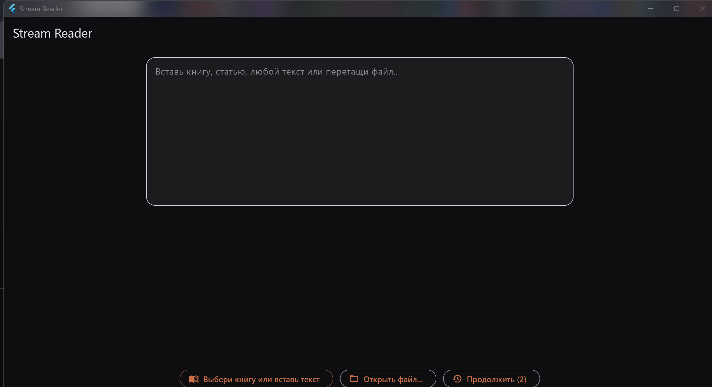
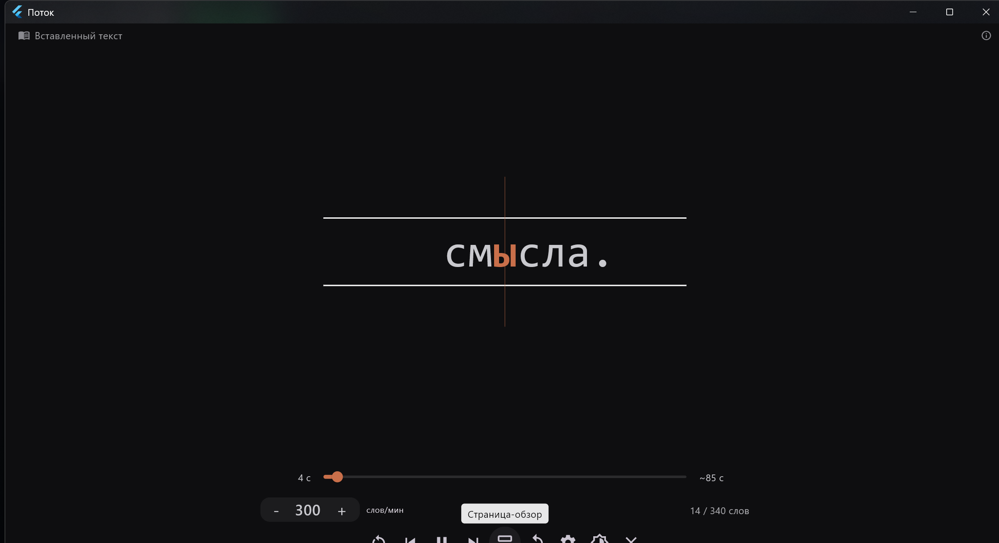
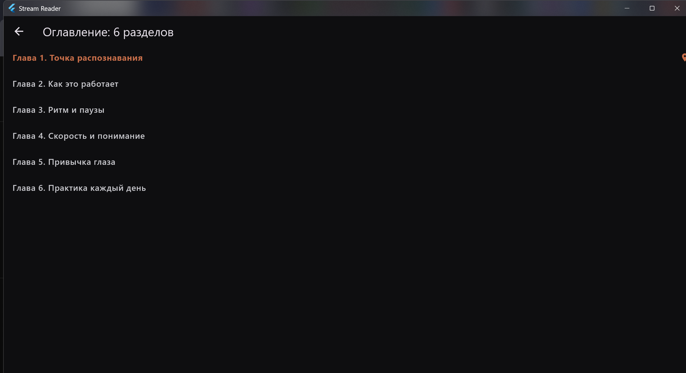

# Stream Reader (Поток)

Stream Reader is an RSVP speed-reading app: words are shown one at a time at a fixed focal point, so your eyes never move. Built with Flutter, one screen, no accounts, works offline.

**Languages:** Russian, English, German, Polish (follows the system language).


## Why speed reading

An average adult reads at 200-250 words per minute, and loses roughly 10% of reading time just moving the eyes across the line. Stream Reader removes that overhead: the text is streamed to a fixed focal point, so your eyes stay still while words flow through.

- **Time.** At 400-600 wpm a book that took 6 hours takes 2-3. Articles, docs and mail shrink the same way.
- **Focus.** One word at a time at a fixed point keeps attention on the text instead of hunting for the line - useful on small screens and for easily distracted readers.
- **Comfort.** No line tracking, no page scrolling, no re-reading by accident; punctuation-driven pauses keep the rhythm of the sentence.
- **Control.** Speed is adjustable on the fly (100-1500 wpm), any moment is one tap away through the seek bar and the outline.

Honest note: comprehension is a trade-off - the faster you go, the more attention the text demands. Stream Reader is built for non-fiction, articles and working through personal libraries, not for skimming poetry.

## Screenshots

| Home | Reader | Outline |
| --- | --- | --- |
|  |  |  |

## Features

- RSVP reading with an ORP (optimal recognition point) - the focus letter is always on the same axis
- Speed control: 100-1500 words per minute, live slider and seek bar with time elapsed / remaining
- Jump ±50 words, restart, reread-sentence (B), space = play/pause
- Outline view: builds a table of contents from short heading lines and `#` / `##` markup, tap to jump
- Font size 24-140, light/dark theme
- Reading progress is remembered per book and offered as "Resume"
- "My books" shelf on Android: opened books are copied to `Documents/My books`
- Formats: TXT, FB2, EPUB, DOCX, DOC, RTF, ODT, PDF, MOBI/AZW/AZW3/PRC

## Platforms

| Platform | Status |
| --- | --- |
| Android | APK (arm64 + armv7), tested |
| Windows | portable zip, tested |
| iOS | source ready, build needs macOS/Xcode |

## Build

```bash
flutter pub get
flutter build apk --release --target-platform android-arm64,android-arm
flutter build windows --release
```

## License

MIT - see [LICENSE](LICENSE).
